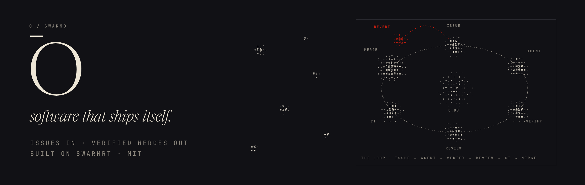

[](https://github.com/skyblanket/o/actions/workflows/check.yml)
[](LICENSE)

# O

**An autonomous software loop.** O watches an issue board, which can be its
own or your GitHub issues, and dispatches coding agents into isolated git
worktrees. It judges their work by your real test suite, a reviewer model and
your CI, merges what passes and reverts what regresses. It budgets itself by
the day and files its own follow-up work, from the failures it catches and from
a daily pass where it reflects on what it shipped.

It runs as one native daemon (`swarmd`) built on
[swarmrt](https://github.com/skyblanket/swarmrt). There is no queue, no
Postgres and no container: an embedded SQLite file is the whole control plane.

### What a merge has to get through

| Gate | What it checks |
|---|---|
| **Grounded verify** | Your `verify_cmd` passes in the agent's worktree. The agent's own claim of success counts for nothing. |
| **Protected paths** | Nothing in the fence was touched, renamed or deleted. The tests that judge the agent sit behind it. |
| **Review gate** | A second, read-only model approves the diff against the issue (`O_REVIEW=1`). |
| **CI** | In PR mode, your repo's own checks go green on the PR (`ship: "pr"`). |
| **Merge gate** | O builds and runs the PR merged with main and proves new tests fail without the change. Then a reviewer of its own (Opus by default, reviews in parallel, sharing the repo's notes) probes it and returns APPROVE, REJECT or UNVERIFIED (`O_MERGE_GATE=1`). |
| **Post-merge verify** | Still green on main after the merge. If not, O auto-reverts and files a fix. |

Every red verdict goes back to the agent with the actual failure output, so it
retries against the real breakage. Agents can run sandboxed with bubblewrap
(`O_SANDBOX=bwrap`). Spend is metered against daily and monthly caps, and a
no-signal breaker pauses any company that burns budget without shipping.

```
   GitHub issues ─┐                ┌──────────────────── swarmd ────────────────────┐
   operator / UI ─┼─▶ issue board ─┼─▶ dispatch ─▶ agent in git worktree (sandboxed) │
   feedback widget┘       ▲        │                 │                              │
                          │        │                 ▼                              │
                          │        │   verify ─▶ review ─▶ ship ──┬─ merge: local   │
                          │        │     │red      │reject        │  --no-ff merge  │
                          │        │     ▼         ▼              │  + post-merge   │
                          │        │   retry with the failure     │    verify       │
                          │        │   (attempts exhausted:       └─ pr: push + PR, │
                          │        │    Failed + fix issue)          CI-gated merge │
                          │        │                                     │          │
                          │        │                regressed ─▶ revert  │  green   │
                          └────────┼──── auto-filed fix issues ◀─────────┘  ▼ Done  │
                                   │   daily: budget rollover · reflection pass     │
                                   └────────────────────────────────────────────────┘
```

## Quick start

Prerequisites: a C toolchain (`cc`, `make`), `git`, `perl`, `python3` and the
`sqlite3` CLI (the test suites query the control plane with it); Node for the UI
and the MCP server; `claude` on `PATH` for real agent runs.

O builds with the swarmrt toolchain. Clone swarmrt as a sibling of this repo
(the default the Makefile expects), build its compiler, then build O:

```sh
git clone https://github.com/skyblanket/swarmrt   # sibling of this repo
(cd swarmrt && make swc libswarmrt)
git clone https://github.com/skyblanket/o
cd o
make                 # -> bin/swarmd   (or: make SWARMRT=/path/to/swarmrt)
make check-fast      # ~10s: build + held-out invariants (run before every push)
make check           # ~2.5 min: full hermetic end-to-end suite (sim runtime, no tokens)
./scripts/acceptance.sh                  # whole-loop acceptance, stub agent
O_ACCEPT_REAL=1 ./scripts/acceptance.sh  # same, with a real claude agent (spends tokens)
```

Run the daemon and the web UI together:

```sh
make dev             # swarmd on :4100 + the React UI on :5173
open http://localhost:5173
```

Point O at a repo it should maintain — including itself:

```sh
./scripts/seed-maintainer.sh          # an "O Core" company that maintains this repo
./scripts/seed-example.sh             # a sim-runtime demo company, no tokens spent
```

Drive O from Claude Code over MCP (`mcp/node_modules` is not committed):

```sh
(cd mcp && npm install)
claude mcp add o -- node "$PWD/mcp/server.js"
```

The control plane lives at `~/.o/o.db`; per-issue worktrees live under
`~/.o/workspaces/`. Nothing else is created.

## Run it 24/7

O is a long-running daemon. Give it a machine that stays up (your Linux box
or a small VM), and it keeps working its repos:

```sh
git clone https://github.com/skyblanket/o && cd o
gh auth login            # GitHub access for issues and PRs
claude                   # log in once, interactively
deploy/install.sh        # builds swarmrt + O, installs a systemd user service
loginctl enable-linger "$USER"   # keep it running after you log out
```

Settings live in `~/.config/o/o.env` (start from `deploy/o.env.example`: set
`O_API_TOKEN`, keep `O_SANDBOX=bwrap`, choose `O_MERGE_GATE` or
`O_PR_AUTOMERGE=0`). Then use `systemctl --user restart o` and
`journalctl --user -u o -f`. Restarts are safe: in-flight issues are recovered
with their attempt counts. To add a repo, clone it on the machine and create a
company with `ship: "pr"`, `github_repo` and a `.o-review.json` in the repo.

## Safety model

O edits real repositories on its own. The guard rails are the point.

- **Agent sandbox (Linux, `O_SANDBOX=bwrap`).** Agent and reviewer runs see a
  read-only filesystem. They can write only their own worktree, the repo's
  `.git` (with `config` and `hooks` kept read-only, since both can make git run
  commands), `~/.claude` and `/tmp`. `~/.o` is hidden, and a private PID
  namespace keeps the daemon's environment (and `O_API_TOKEN`) out of reach.
- **Grounded verifier.** A change is judged only by running the company's real
  `verify_cmd` in the worktree — never by the agent's own claim of success. A run
  that makes no commit, that touches a protected path, or whose verify command
  fails does not merge. Verdicts are recorded per run: `red_no_commit`,
  `red_protected`, `red_tests`, and so on.
- **Review gate (opt-in, `O_REVIEW=1`).** Passing tests prove the tests pass,
  not that the change is right. With the gate on, a second, read-only model
  reviews each green diff against its issue before merge; a rejection is a
  `red_review` verdict whose reason feeds the next attempt's prompt. It fails
  closed: no parseable verdict counts as a rejection.
- **Protected paths.** Each company declares `protected_paths`. An agent may not
  change them; a commit that does is rejected (`red_protected`) before it can
  merge. Renames count as touching both paths, and the agent's prompt lists the
  fence. A builder whose task needs a protected file commits nothing and ends
  with `NEEDS_HUMAN: <the change>`: the issue parks In Review with that ask
  (`run.needs_human`) instead of burning its attempts. The test harness and this loop's own invariants live behind it, so an
  agent maintaining O cannot edit the checks that gate its merges.
- **Guarded control plane.** Writes must be `Content-Type: application/json` and
  CORS preflights are answered only for loopback origins, so a web page can't
  drive the API. Set `O_API_TOKEN` to require `Authorization: Bearer` on
  company / agent / approval writes (filing issues and feedback stays open);
  agent subprocesses never receive the token, so an agent can't rewrite its own
  `verify_cmd` or `protected_paths` through the API.
- **Everything on a branch.** Each issue runs on `o/<issue>` in its own worktree.
  Green work lands with a `--no-ff` merge that names the branch. If the merge
  regresses the base (post-merge verify goes red, and stays red on a re-run so a
  single flaky test doesn't count), O reverts the merge on the base branch and
  **keeps the branch** for forensics.
- **Budget circuit breakers.** Every run is metered onto the company's daily and
  monthly budgets; a run killed on its wall-clock cap (which reports no cost) is
  charged a flat estimate. Hitting a cap pauses the company (`budget-daily` /
  `budget-monthly`). A separate **no-signal** breaker pauses a company that burns
  budget across days without shipping a single verified-green merge.
- **Bounded self-filing.** When O files its own follow-up work (a regression to
  fix, a repeated stall, a no-signal diagnostic, a reflection idea) it is
  guarded: **depth-1** (an auto-filed issue that itself fails files no child, so
  a red loop can't fork-bomb), **fingerprint dedup** (one open issue per failure
  fingerprint), and a **daily cap** per company.

## GitHub in / out

Point a company at a GitHub repo and O works its issue tracker and ships
through its CI. `repo` must be a local clone whose `origin` is that repo, and
`github_repo` must be its `owner/name`. O talks to GitHub only through
`gh api` (REST), so it needs an authenticated `gh`, but not GitHub's GraphQL API.

```sh
curl -s -X POST localhost:4100/api/companies -H 'Content-Type: application/json' -d '{
  "name": "Widgets", "issue_prefix": "WID",
  "repo": "/path/to/widgets-clone", "verify_cmd": "make test",
  "protected_paths": "tests/,.github/",
  "github_repo": "acme/widgets", "ship": "pr",
  "budget_daily_cents": 2000 }'
```

- **In:** every `O_GH_POLL_S` O imports open issues labelled `O_GH_LABEL`
  (default `o`) as `origin: "github"` work items, each exactly once.
- **Out (`ship: "pr"`):** each issue branch forks from `origin/<base>`. Once it
  passes `verify_cmd` (and the review gate, if on), O pushes it and opens a PR
  (`Closes #n` for imported issues). The repo's own CI is the merge gate: all
  checks green means `gh pr merge`. A failing check (`red_ci`) or a conflict
  goes back to the agent, and its next push updates the same PR. If GitHub
  refuses the merge (required reviews, say), the issue parks in **In Review**
  with the PR open for a human.
- **In Review is watched.** Each poll checks parked PRs. One a human merged
  becomes Done (`pr.merged`), and one a human closed becomes Canceled
  (`pr.closed`). With the merge gate on, a PR that PR-only mode parked is
  adopted by the maintainer (`pr.adopted`). Gate escalations and merges GitHub
  refused are never re-adopted.
- `ship: "merge"` (the default) keeps the local serialized merge, with
  post-merge verify and auto-revert.

### Merge gate: a reviewer that runs the code

With `O_MERGE_GATE=1`, a PR whose CI is green isn't merged automatically.
Each PR gets its **own reviewer** (`O_MERGE_MODEL`, default `claude-opus-5-5`)
in its own workspace, so reviews run in parallel with no queue, and nothing
merges on reading alone.

**1. O's own checks run first, with no model involved.** O makes a
disposable clone of the PR **merged with current base**. It has no git
remotes, and `GH_TOKEN` is stripped, so nothing in it can push. In that clone
O runs the commands from `.o-review.json`:
- the build
- every new or changed test, which must pass on the PR **and fail on base
  without the change**, so a new test that can't fail is a REJECT. A
  *modified* test that also passes on base (an un-skip, a refactor) proves
  nothing either way: it is noted for the reviewer, not rejected
- the suite, but only when the repo names no `required_checks`: otherwise CI
  already ran it on this same merge commit
- the extra commands of the change's risk tier. One that fails is re-run on
  base: failing there too is pre-existing and noted, not blamed on the PR;
  passing there gets the PR one retry, and only a repeat failure blocks

The first unexpected result is a REJECT, and the model is never asked.

**2. Then the reviewer probes, building and running in that clone.** It
has Bash there, and a rubric that makes it look for reasons the change is
wrong: kill the caller, check what runs after `fork()`, run concurrent calls,
try another OS, look for tests that pass by default, and probe cases beyond
the issue's list. It is told what O and CI already ran, so it doesn't repeat
them.

**Shared context:** every review starts with the repo's shared notes,
`~/.o/maintainer/<company>/NOTES.md`, in its prompt. A review can end with up
to three `NOTE: <lesson>` lines (a convention, a pitfall, how to test an
area). O, the only writer, appends them for the next reviews, deduped and
capped.

**3. The verdict is the last `VERDICT:` line.** The same protocol is used for
the pre-PR screen.

| Verdict | Result |
|---|---|
| `APPROVE` | Merged, unless the change's tier needs a human. |
| `REJECT: <findings>` | `red_merge_gate`: the findings go to the builder, and its next push updates the same PR. |
| `UNVERIFIED: <what couldn't run>` | Waits for a human. A missing verdict counts as UNVERIFIED, and so does an APPROVE from a session that ran no command at all. |

**4. Evidence:** every decision is posted on the PR, with O's check log and
every command the maintainer ran (taken from its tool calls, not its own
summary).

#### `.o-review.json`
The file is read from the **base** branch, so a PR can't relax the checks
that judge it. Protect `.o-review.json` with `protected_paths`. (It is a root file rather than an `.o/` directory because C projects routinely `.gitignore` `*.o`, which would hide `.o/`.)

```json
{ "build": "make swc libswarmrt",
  "suite": "make test-sw",
  "test_runners": [
    { "paths": ["tests/sw/test_"], "cmd": "./bin/swc build {file} -o /tmp/o-t && /tmp/o-t", "prove_fails": true } ],
  "required_checks": ["quickstart", "hardening-gates", "macos", "fuzz"],
  "tiers": [
    { "name": "docs",     "paths": ["docs/", "README.md"], "merge": "auto", "required_checks": ["quickstart"] },
    { "name": "language", "paths": ["src/swarmrt_lang.c", "lib/"], "merge": "auto", "extra": ["make test-sw"] },
    { "name": "runtime",  "paths": ["src/"], "merge": "human", "extra": ["make test-full"] } ],
  "default_merge": "human" }
```

- **CI must be green on the PR merged with current base:** every
  `required_checks` name has to have reported success, and when base moves on,
  O updates the PR branch and waits for CI again.
- **CI by tier:** a tier can set its own `required_checks`, so a docs change
  waits for the quick check, not a 14-minute sanitizer job. A PR needs the
  union over the files it touches. A file in no tier, or in a tier without the
  key, needs the top-level list.
  Only the required checks decide: other jobs on the PR are neither waited
  for nor blamed.
- **A failed CI job is re-run once** (per head commit) before the change is
  blamed. Runner and mirror hiccups pass on the re-run; a failure that repeats
  goes back to the builder as `red_ci`. `O_CI_RERUN=0` turns it off.
- **Adopted PRs wait for CI too:** a PR picked back up from In Review (for
  example after a restart) goes through the same CI wait before the gate.
- **One PR per issue:** when O gives up on an issue, it closes that issue's PR
  with the reason, so a superseded attempt can't be merged. The follow-up issue
  carries the `Closes #N` link.

O acts with your GitHub token, and GitHub won't let a PR's author approve their
own PR. So the maintainer's review is a comment, and the merge works as long as
branch protection doesn't require an approving review.

### O on O

O maintains its own repo the same way. This repo's [`.o-review.json`](.o-review.json) splits changes into tiers:
- **Automatic on APPROVE:** docs, UI, and the API/store code.
- **Needs a human:** changes to the gate and sandbox (`src/orchestrator.sw`).

Run the company with `verify_cmd: "make check-fast"` and protected paths `tests/heldout/,scripts/check.sh,.github/,.o-review.json`, and set `SWARMRT=/path/to/swarmrt` in the daemon's environment so agents and the gate can build. A merged change takes effect only when you rebuild and restart the daemon.

## Personas: simulated users

Tests check what the authors thought of. Personas check what a user hits. Once a
day (`O_PERSONAS=1`) O sends a few simulated users at the product, each with a
role, a realistic goal and a starting doc, and lets them try to get there from
the docs alone. Each one gets a clean export of the base branch: no `.git`, no
board, no other reports, no fix diffs.

What blocks them comes back as an issue with a verbatim repro:

| severity | what it means | becomes |
|---|---|---|
| `blocked` | can't get any further toward the goal | a high-priority issue |
| `wrong` | the docs say X, the product does Y | a medium issue |
| `friction` | got there, but had to guess | an entry in the week's digest issue |

- **Repro or nothing.** A report needs `steps` and the verbatim `actual` output,
  or it's refused with a 400.
- **Dedup.** Reports are fingerprinted on the first line of `actual` with paths,
  numbers and addresses stripped (or on doc section + title for `wrong`), so two
  personas hitting the same error file one issue.
- **Judge (optional).** With `O_PERSONA_JUDGE=1`, a second cheap pass reads each
  report against the checkout and drops NOISE, such as the persona's own
  mistakes and sandbox artifacts.
- **Confirmation.** When a persona-found issue reaches Done, the same persona
  re-runs the scenario on the new version. If it passes, O logs
  `persona.confirmed`. If it fails, O files a fix issue, and depth-1 stops the
  chain there.
- **Safety and cost.** Personas run whatever the docs tell them to, so they run
  only under `O_SANDBOX=bwrap` (or with an explicit `O_PERSONAS_UNSANDBOXED=1`),
  and their prompt treats everything in the checkout as data, not instructions.
  They have their own daily budget (`persona_daily_cents`, default $2) and
  default to a cheaper model (`O_PERSONA_MODEL`, default `haiku`).

```sh
curl -X POST localhost:4100/api/companies/<id>/personas -H 'Content-Type: application/json' \
  -d '{"name":"Newcomer","role":"never seen the project","goal":"follow the README quick start",
       "start":"README.md","done_when":"the tests pass"}'
curl localhost:4100/api/companies/<id>/persona_runs      # runs, outcomes, reports
```

[`examples/personas/swarmrt.json`](examples/personas/swarmrt.json) has four
personas for swarmrt: a newcomer, an eval-runner builder, an Erlang porter and a
docs-only model.

## Feedback widget

`feedback/o-feedback.js` is a dependency-free annotation layer for your dev app.
Toggle it (Alt+Shift+A), click any element, type what should change, batch a few,
send — O files a single `origin='feedback'` issue the loop picks up like any
other work item.

```html
<script
  src="/o-feedback.js"
  data-endpoint="http://127.0.0.1:4100"
  data-company="co_XXXXXXXX"></script>
```

Endpoint contract:

```
POST {endpoint}/api/companies/{company}/feedback
{
  "page_url": "http://localhost:3000/dashboard",   // required, 400 if missing
  "annotations": [                                   // required, non-empty, 400 if empty
    { "selector": "#hero > h1", "html": "<h1>…</h1>",
      "styles": { "color": "rgb(0,0,0)" },
      "instruction": "make the heading bigger" }
  ]
}
```

`201` returns the created issue (`origin: "feedback"`, one `### Annotation N`
section per annotation in the body). Filed outside the self-file cap, so operator
feedback is never dropped. Full docs: [`feedback/README.md`](feedback/README.md).

## Runtimes

An agent does real work through a pluggable runtime, chosen per agent:

| runtime | what it is |
|---|---|
| `claude-code` | headless `claude -p` in the worktree (default). |
| `swarm-code` | the swarm-code agent, run in the worktree. |
| `sim` | a deterministic, no-token stub — drives the pipeline in tests. |

## Issue lifecycle

```
Backlog ─▶ In Progress ─▶ Verifying ─▶ Done        (ship=pr: ─▶ In Review when GitHub wants a human)
                │              │
                │              ├─▶ Failed     (verify red, attempts exhausted)
                │              └─▶ Reverted   (regressed the base after merge)
                └──────────────── Canceled    (operator)
```

Every transition and decision is written to an append-only activity log
(`GET /api/activity`). Verbs include: `run.dispatch`, `run.succeeded`,
`run.failed`, `run.failed_final`, `run.stalled`, `verify.start`, `verify.pass`,
`verify.fail`, `merge.queued`, `merge.done`, `merge.revert`, `merge.conflict`,
`merge.dirty`, `selffile.created`, `selffile.duped`, `selffile.capped`,
`selffile.skipped_depth`, `budget.reset`, `budget.exceeded`, `budget.no_signal`,
`reflect.spawn`, `reflect.filed`, `reflect.done`, `feedback.filed`,
`issue.create`, `issue.update`, `agent.hire`, `company.create`.

## Environment

The daemon reads its configuration from the environment. All are optional.

| variable | default | meaning |
|---|---|---|
| `SW_SCHEDULERS` | CPU count | scheduler threads (a swarmrt setting). Each running agent, verify, gate review or persona holds one while its subprocess runs, and when all are held the API and orchestrator stall; set it well above how many can run at once (`deploy/o.env.example` uses 32). |
| `O_TICK_MS` / `O_BACKOFF_MS` | `5000` / `2000` | orchestrator tick and base retry backoff in ms (the test suite runs at 500 / 300). |
| `O_MAX_CONCURRENT` | `3` | agent runs (build, verify, review) in flight across all companies. PRs waiting on CI, the gate or a merge hold no slot. Keep `SW_SCHEDULERS` above twice this. |
| `O_DB` | `~/.o/o.db` | control-plane SQLite path. |
| `O_PORT` | `4100` | HTTP port. |
| `O_CLAUDE_BIN` | `claude` on `PATH` | claude-code binary for the `claude-code` runtime. |
| `O_SWARM_BIN` | `swarm-code` on `PATH` | binary for the `swarm-code` runtime. |
| `O_MAX_TURNS` | `50` | per-run turn cap passed to claude-code. |
| `O_STALL_TIMEOUT_S` | `600` | wall-clock cap on one agent run, in seconds. |
| `O_VERIFY_TIMEOUT_S` | `600` | wall-clock cap on a single verify command. |
| `O_GLOBAL_DAILY_CENTS` | unset | global daily spend ceiling across all companies; dispatch stops for the day when met. |
| `O_SELF_FILE_CAP` | `10` | max auto/reflect issues one company may file per day. |
| `O_NO_SIGNAL_DAYS` | `2` | consecutive no-signal days before the breaker pauses a company. |
| `O_SWARM_FLAT_CENTS` | `25` | flat per-run cost charged for a swarm-code run (it reports no telemetry yet). |
| `O_REFLECT` | unset | set `1` to enable the daily reflection pass. |
| `O_REQUIRE_APPROVALS` | unset | set `1` to route agent hiring through `/api/approvals`. |
| `O_API_TOKEN` | unset | when set, company / agent / approval writes need `Authorization: Bearer <token>`. The UI reads `VITE_O_TOKEN`, the MCP server `O_API_TOKEN`. |
| `O_TIMEOUT_FLAT_CENTS` | `300` | cost charged for an agent run killed on its wall-clock cap. |
| `O_REVIEW` | unset | set `1` to require a reviewer model's APPROVE before any green change merges. |
| `O_MODEL_LADDER` | `haiku,sonnet,opus` | builder models. Every issue starts on the first, unless a `.o-review.json` tier names a stronger `builder` (e.g. `"builder": "sonnet"` on the runtime tier): an issue whose text names one of that tier's paths, or whose earlier attempt touched them, starts there. Retries stay on the same model, with the verdict in the prompt. A run moves up one rung only when the agent itself ends it with `ESCALATE: <why>`. An agent's own `model` overrides the ladder; `""` uses the CLI default. |
| `O_AUTO_FILE` | on | when an issue fails for good, O files a "Fix failing verification" follow-up (one level deep). `0` turns it off: the failed issue waits for a human. Revert follow-ups (main regressed) are always filed. |
| `O_VERIFY_RETRY` | `1` | a failed verify is re-run once before it counts. Fail-then-pass is logged `verify.flaky` and ships with no retry. `0` turns it off. |
| `O_REVIEW_MODEL` | `sonnet` | model for the pre-PR reviewer. |
| `O_GH_BIN` | `gh` on `PATH` | GitHub CLI used for issue import and PRs. |
| `O_GH_LABEL` | `o` | only open GitHub issues with this label are imported. |
| `O_GH_POLL_S` | `60` | GitHub issue poll interval. |
| `O_CI_POLL_S` / `O_CI_TIMEOUT_S` | `30` / `3600` | PR check poll interval / give-up deadline (`red_timeout`). |
| `O_PR_AUTOMERGE` | `1` | set `0` for PR-only mode: a green PR parks in **In Review** for a human to merge. |
| `O_CI_SETTLE_S` | `30` | how long a PR with no checks reported waits before counting as "no CI, green". |
| `O_SANDBOX` | unset | `bwrap` confines agent + reviewer runs with bubblewrap (Linux). |
| `O_SANDBOX_RW` | unset | extra comma-separated paths the sandbox keeps writable, if your agent CLI needs them. |
| `O_MERGE_GATE` | unset | `1` sends every green PR to a merge-gate reviewer of its own (APPROVE / REJECT / UNVERIFIED), reviews in parallel. |
| `O_MERGE_MODEL` | `claude-opus-5-5` | the merge-gate reviewer's model. |
| `O_ESCALATE_PATHS` / `O_ESCALATE_LINES` | unset / `1000` | PRs touching these path prefixes, or bigger than this, always go to a human (on top of `.o-review.json` tiers). |
| `O_GATE_TIMEOUT_S` / `O_GATE_MAX_TURNS` | `3600` / `80` | wall-clock and turn caps for one gate review, checks included. |
| `O_PERSONAS` | unset | `1` turns on the daily persona pass (needs `O_SANDBOX=bwrap` or `O_PERSONAS_UNSANDBOXED=1`). |
| `O_PERSONA_MODEL` | `haiku` | default model for personas (a persona's own `model` wins). |
| `O_PERSONA_MAX_TURNS` / `O_PERSONA_TIMEOUT_S` | `40` / `900` | turn and wall-clock caps for one persona run. |
| `O_PERSONA_JUDGE` / `O_PERSONA_JUDGE_MODEL` | unset / `haiku` | `1` runs a REAL-or-NOISE judge over each report before it's filed. |
| `O_VERIFY_RERUNS` | `1` | post-merge verify re-runs before a red result counts as a regression. |

## API

```sh
curl http://localhost:4100/api/health
curl http://localhost:4100/api/companies
curl -X POST http://localhost:4100/api/companies \
  -d '{"name":"Core","issue_prefix":"COR","repo":"/path/to/repo",
       "verify_cmd":"make test","protected_paths":"ci/,scripts/",
       "budget_daily_cents":5000,"budget_monthly_cents":100000}'
curl -X POST http://localhost:4100/api/companies/<id>/agents \
  -d '{"name":"Maintainer","runtime":"claude-code","repo":"/path/to/repo"}'
curl -X POST http://localhost:4100/api/companies/<id>/issues \
  -d '{"title":"first task","priority":"high"}'

curl http://localhost:4100/api/orchestrator   # live scheduler snapshot
curl http://localhost:4100/api/runs           # run history
curl http://localhost:4100/api/activity       # activity log
```

## Known limitations

- **Single-node.** One daemon, one SQLite control plane, one machine. There is no
  clustering and no multi-writer coordination.
- **Without `O_SANDBOX` the machine is the trust boundary.** Agents run with
  `--dangerously-skip-permissions`, so they can run arbitrary commands as your
  user. Protected paths and the verify gate constrain what *merges*, not what an
  agent may *do* while working. Turn on `O_SANDBOX=bwrap` on Linux. Even then
  network access stays open (the agent needs the model API), and macOS has no
  sandbox backend yet.
- **The API token needs the sandbox to be airtight.** Unsandboxed agents run as
  your user and could read the token out of the daemon's environment. With
  `O_SANDBOX=bwrap` they can't. Either way, bind the API to localhost.
- **swarm-code cost is estimated.** swarm-code emits no usage telemetry yet, so
  its runs are metered at a flat per-run estimate (`O_SWARM_FLAT_CENTS`) rather
  than true token cost.

## Built on swarmrt

O is written in the `sw` language and runs on the swarmrt runtime —
<https://github.com/skyblanket/swarmrt>.

## License

MIT — see [LICENSE](LICENSE).
